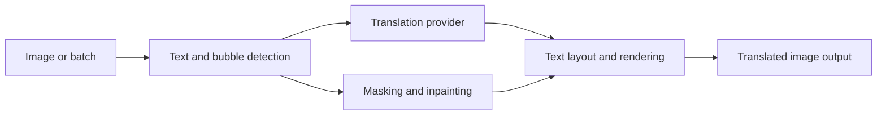

# Manga Translator

A downstream edition of [meangrinch/MangaTranslator](https://github.com/meangrinch/MangaTranslator) for detecting, translating, cleaning, and typesetting text in manga and comic pages.

## Pipeline



Detection, image cleaning, translation, and rendering are coordinated by [core/pipeline.py](core/pipeline.py). The [image modules](core/image/) handle detection and cleaning; [translation service](core/services/translation.py) and [endpoint adapters](utils/endpoints/) connect providers; [text modules](core/text/) handle typography. [app.py](app.py) starts the Gradio interface, while [main.py](main.py) provides a command-line batch interface.

## Setup

Python 3.10 or newer is required. Model downloads and hardware requirements depend on selected features; consult [hardware requirements](docs/HARDWARE_REQUIREMENTS.md), [fonts](docs/FONTS.md), and [troubleshooting](docs/TROUBLESHOOTING.md).

```sh
git clone https://github.com/Gehrman-Sparrow42/manga-translator.git
cd manga-translator
python -m venv .venv
```

Activate the environment, then install the project:

```sh
python -m pip install .
python app.py
```

The web interface defaults to port `7676`; use `python app.py --help` for options such as `--cpu`, `--models`, and `--fonts`. The CLI requires an input path:

```sh
python main.py --help
python main.py --input path/to/page.png --output path/to/output.png
python main.py --input path/to/pages --output path/to/output --batch
```

Configure a translation provider in the application as needed. [.env.example](.env.example) lists provider and endpoint settings; keep credentials private. Cloud translation sends content to the selected provider and may incur usage charges. The available model, fonts, provider access, and hardware determine which processing options work; review generated translations and layouts before use.

## Development and attribution

Install the optional development dependencies with `python -m pip install ".[dev]"`, then run `python -m pytest`. This repository is a customized downstream distribution of [meangrinch/MangaTranslator](https://github.com/meangrinch/MangaTranslator). See the [Apache 2.0 license](LICENSE) and the upstream project for credits.
